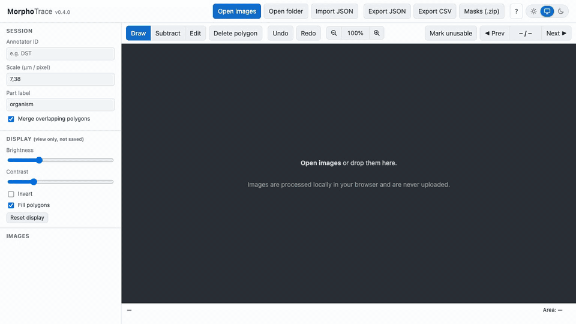
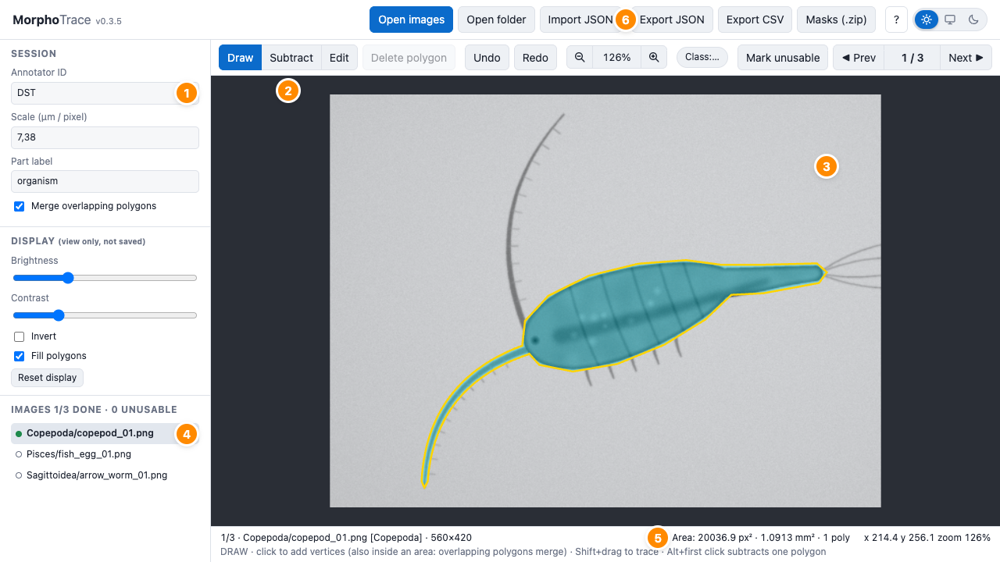
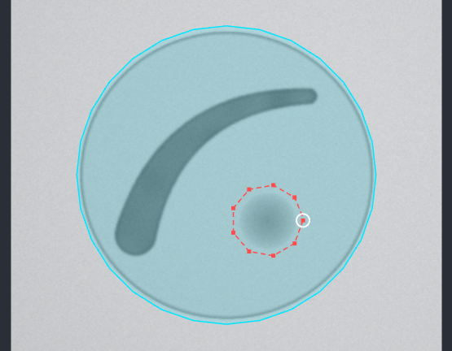
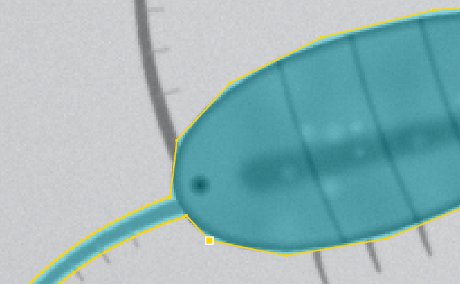
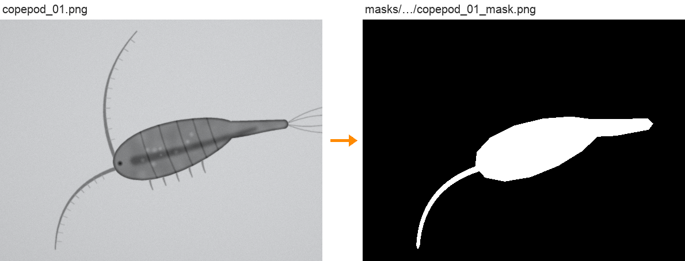

# MorphoTrace

**Outline organisms in your images and get their projected area in px² and mm², plus binary masks.** A browser tool for building manual reference measurements (ground truth) for plankton and other microscopy images. Nothing to install, and images never leave your computer.

<p align="center">
  
</p>

[](https://github.com/dvdsosa/morphotrace/actions/workflows/tests.yml) · MIT licence · Zenodo DOI: see [`CITATION.cff`](CITATION.cff)

## Open the tool

- **Online:** https://dvdsosa.github.io/morphotrace/
- **Offline:** download the repository and open `index.html`, or serve the folder, which keeps the autosave tied to one address:

```bash
python3 -m http.server 8765    # then open http://localhost:8765
```

Works in current Chrome, Edge, Firefox and Safari. Images are read by your browser and never uploaded. Chrome may still ask *"Upload N files to this site?"* when you open a folder: that is the browser's generic wording, and you can accept it.

## Annotate in six steps

### 1. Set up the session



| # | Part |
|---|---|
| **1** | **Session**: your initials (*Annotator ID*), the image scale in **µm per pixel**, and the *Part label* (`organism` unless your protocol says otherwise). They are remembered and written into every export. |
| **2** | **Modes**: **Draw** (`D`) adds area, **Subtract** (`S`) removes it, **Edit** (`E`) selects and reshapes. |
| **3** | **Image**: zoom at the cursor with `Shift` + wheel (or pinch), scroll with the wheel. |
| **4** | **Image list**: a green dot marks annotated images, an orange dot unusable ones. Click one to open it, or use `←` / `→`. |
| **5** | **Area** of the current image in px² and mm², updated as you draw. |
| **6** | **Export** areas (CSV), outlines (JSON) or masks (ZIP). |

### 2. Open your images

**Open folder** loads every image in a folder. If the folder has one sub-folder per class (e.g. `Copepoda/`, `Pisces/`), each image's class is taken from its sub-folder and saved with it. **Open images** (or dragging files onto the window) loads single files.

### 3. Outline the organism

In **Draw** mode:

- **Click** along the edge to place vertices; place more of them where the outline curves or along thin appendages.
- **`Shift` + drag** traces freehand. You can mix clicks and freehand in one outline.
- **Close** the outline by clicking the first vertex (a white circle appears), pressing `Enter`, or double-clicking.
- An outline closed **over an existing area merges** with it: add a forgotten antenna or leg as a separate outline that starts inside the body.
- Right-click or `Backspace` removes the last vertex; `Esc` cancels the outline.

**Faint edges?** *Brightness*, *Contrast* and *Invert* in the side panel change only what you see, never the measurement.



**Remove area** with **Subtract** (`S`): the trace is red and dashed, and the part it covers is cut away when you close it. Drawn entirely inside an area, it makes a **hole**. `Alt` + first click subtracts one outline without leaving Draw mode.

<br clear="right">

### 4. Refine the outline



In **Edit** mode (`E`):

- **Click** an area to select it; `Del` deletes it.
- **Drag** a vertex to move it.
- **Double-click** the outline to add a vertex there.
- **Hover** a vertex until it grows, then **right-click** it (or `Alt` + click) to delete it.

`Ctrl/⌘ + Z` undoes and `Ctrl/⌘ + Shift + Z` redoes, separately for each image.

### 5. Next image, or mark it unusable

`→` opens the next image. If a specimen cannot be measured (cut by the image edge, out of focus, several organisms overlapping), press `X` and give a short reason: it is exported as `unusable` instead of with an area.

### 6. Export

| Button | File | Contents |
|---|---|---|
| **Export CSV** | `areas_<date>.csv` | one row per image: class, status, area in px² and mm², perimeter, time spent |
| **Export JSON** | `annotations_<date>.json` | everything, including every vertex; use **Import JSON** to resume or review |
| **Masks (.zip)** | `morphotrace_<date>.zip` | a black-and-white PNG mask per annotated image, plus the JSON and the CSV |



A CSV row looks like this (some columns left out, mm² rounded):

```csv
rel_path,class,status,width,height,area_px_polygon,area_mm2_polygon,area_px_mask,perimeter_px,time_s
Copepoda/copepod_01.png,Copepoda,annotated,560,420,20036.903,1.0913,20046,1064.909,7.6
```

## Tips for consistent outlines

- **Zoom in** (200–400 %) along the edges: each vertex is then placed to a fraction of a pixel.
- **Trace the outer edge** of the organism, the boundary between it and the background, all the way round.
- **Include appendages** as your protocol defines them, and do it the same way on every image.
- **One area per organism.** If parts are drawn separately, let them overlap so they merge.
- **Don't guess** at what the image doesn't show: mark truncated or unclear specimens unusable (`X`).
- **Export JSON** at the end of each session. It is your backup.

## Your work is saved as you go

Every change is autosaved in this browser. Close the tab, come back and open the same folder: your outlines are restored.

The autosave lives in this browser on this computer only. If it cannot save (browser storage full, or a private window), a **red banner** appears with an **Export JSON now** button, and closing the tab asks for confirmation. To move to another computer or browser, export JSON and import it there.

## Keyboard and mouse

| Action | Shortcut |
|---|---|
| Draw / Subtract / Edit mode | `D` / `S` / `E` |
| Add a vertex | Click (Draw, Subtract) |
| Trace freehand | `Shift` + drag (Draw, Subtract) |
| Subtract one outline without leaving Draw | `Alt` + first click |
| Close the outline | Click the first vertex, double-click, or `Enter` |
| Remove the last vertex while drawing | Right-click (without dragging) or `Backspace` |
| Cancel the outline / deselect | `Esc` |
| Select an area · delete it | Click it · `Del` (Edit) |
| Move a vertex | Drag it (Edit) |
| Add a vertex on the outline | Double-click the line (Edit) |
| Delete a vertex | Hover it until it grows, then right-click (or `Alt` + click) (Edit) |
| Turn the selected outline into a hole (advanced) | `H` (Edit) |
| Undo / redo | `Ctrl/⌘ + Z` / `Ctrl/⌘ + Shift + Z` (or `Ctrl/⌘ + Y`) |
| Zoom at the cursor | `Shift` + wheel, or trackpad pinch |
| Zoom in / out · fit · 100 % | `+` / `−` · `F` or `0` · `1` |
| Scroll · pan | Wheel or trackpad · `Space` + drag, or right/middle-button drag |
| Previous / next image · go to number | `←` / `→` (or `P` / `N`) · `G` |
| Mark the image unusable | `X` |
| Help | `?` |

The same list is under **?** in the tool.

## Questions

**I opened the wrong folder.** Reload the page (`F5`) and open the right one. Outlines already drawn are kept for the images they belong to.

**Can two people annotate the same images?** Yes, each in their own browser. Each exports their JSON, which records the annotator ID, and you compare the files afterwards.

**Where is the version?** Next to the name in the top bar. It is also written into every export, so results can be traced back to the tool version that produced them.

## What is measured

- `area_px_polygon`: exact area enclosed by the outlines, from their vertices. Overlapping outlines count once and holes are subtracted. Vertices are in continuous pixel coordinates (pixel *(i, j)* covers [i, i+1) × [j, j+1)) and are kept inside the image.
- `area_px_mask`: number of white pixels in the exported mask, where a pixel is white when its centre lies inside the outlines. Use it to compare with pixel counts from segmentation methods.
- `area_px_by_label`: area per part label, when outlines carry different labels (e.g. `body=2000;appendage=300`).
- `area_mm2_* = area_px × (µm/px)² / 10⁶`.
- An outline that crosses itself is split into simple pieces when it is closed.

Versions before 0.3.0 summed overlapping outlines twice and produced masks about 1–2 % too large; see the [commit history](https://github.com/dvdsosa/morphotrace/commits/main) for details.

## For developers

Plain HTML, CSS and JavaScript with no build step and no package manager, so the tool runs offline from `index.html` and is archived on Zenodo as-is. Any static host serves it (GitHub Pages: Settings → Pages → branch `main`, root). Third-party code is listed in [`THIRD_PARTY_NOTICES.md`](THIRD_PARTY_NOTICES.md).

- **Tests:** `tests/run-all.sh` runs unit, lint, HTML, accessibility and browser tests in Chromium, Firefox and WebKit; see [CONTRIBUTING.md](CONTRIBUTING.md).
- **README media:** the images on this page are synthetic and generated with `docs/media/build.sh` (needs uv, ffmpeg and playwright-cli). Re-run it after interface changes.

Bug reports and pull requests are welcome: see [CONTRIBUTING.md](CONTRIBUTING.md).

## Citation

If you use MorphoTrace, please cite it with the metadata in [`CITATION.cff`](CITATION.cff) (Zenodo DOI).

## Authorship

Developed by D. Sosa-Trejo with AI coding assistance (Claude, Anthropic); the author tested the tool and is responsible for it.

## Licence

MIT
